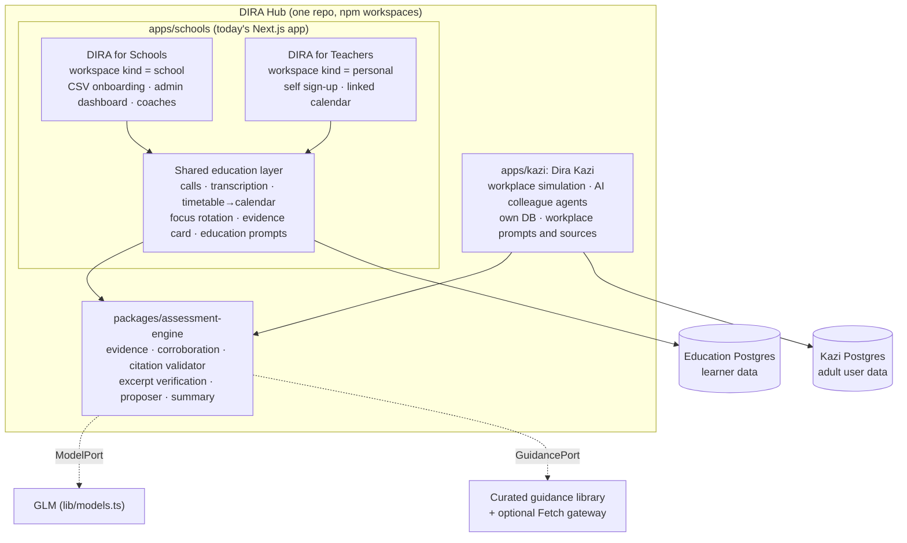
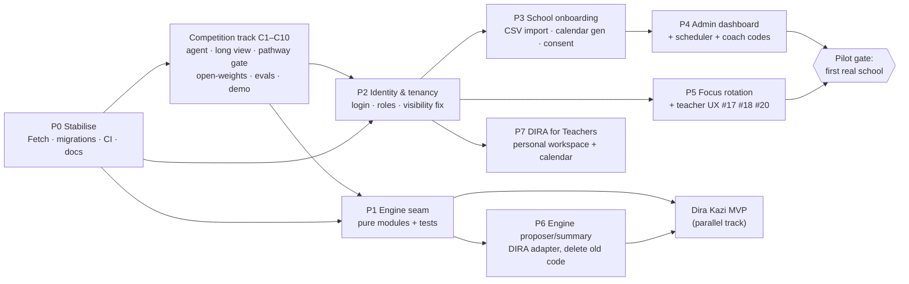

# DIRA Hub Roadmap: from demo to platform

> **Status:** Plan, 13 November 2026 (revised the same day for the Agentic AI for Africa "The Long View" judging). C1–C10 implemented on branch `feature/long-view-readiness` (see §A.3b).
>
> ✅ **Freeze resolved (13 Nov 2026):** the team passed round one and the organisers allowed continued work before the final. Work happens on branch `feature/long-view-readiness`.
>
> **Basis:** Checked against the code on branch `production` (commit `86d30d5`), GitHub issues #15–#23, `DECOUPLING_DIRA.md` and the project pitch. Anything I could not check in the code is marked **UNVERIFIED**.
> **Audience:** The founder, plus any developer or coding agent picking up the work.

---

## 0. Summary of decisions

1. **One hub, three products, one engine.** DIRA Hub contains **DIRA for Schools** (B2B), **DIRA for Teachers** (B2C: tutors, homeschoolers, individual teachers) and **Dira Kazi** (young professionals). All three share one **assessment engine**. Everything else (calls, timetables, schools, agents, simulation) belongs to the product that uses it.
2. **Schools and Teachers are one codebase, not two.** An individual teacher is a *workspace with one member*. The tenant today is a `school` row. We add `kind = 'school' | 'personal'` to it. Every existing `school_id` scoping rule keeps working. The only differences are how the calendar arrives (CSV import vs. a linked Google or Outlook calendar) and who the admin is (a school admin vs. the teacher themself).
3. **Make DIRA usable before extracting the engine, but put the engine seam in early.** DIRA cannot hold real learner data today because it has no login (§2.1). Usability (login, onboarding, admin) is the critical path for Schools. A small, pure-function engine package can be pulled out in about a week so Kazi can build on it in parallel.
4. **The engine is a shared TypeScript package in this repo** (npm workspace `packages/assessment-engine`), used in-process. No network service, so learner data never crosses a new boundary. Kazi becomes a second app in the same repo (`apps/kazi`), with **its own database**.
5. **Drop the shadow-mode ceremony for now.** `DECOUPLING_DIRA.md` plans shadow mode and per-capability flags to protect production teachers. There are none yet; production runs on synthetic data in demo mode. Characterization tests followed by a direct refactor are enough. Shadow mode becomes worth it after the first real school pilot.
6. **School data arrives through CSV templates and an import screen,** with validation and preview before anything is saved. The **calendar is generated** from the timetable, term dates and closures; it is not typed in. Excel works because Excel saves CSV. Direct `.xlsx` upload can come later.
7. **Guidance retrieval moves to a curated library first, live fetch second.** Two of the four allowlisted education sites block automated requests outright (checked, §3). Depending on live scraping makes every Suggest Test run fragile. Kazi needs the same pattern with workplace sources.
8. **The competition comes first, and only Schools + Teachers are presented.** The "Competition track" (§A) is ordered by judging points and comes before onboarding, admin and Kazi work. Kazi and the engine extraction stay on the roadmap but are **not** part of the pitch, apart from one honest "where this goes" line.

**Decided by the founder (13 Nov 2026):** D1 same repo; D3 learner history stays at the old school unless a guardian approves an export; D9 the Fetch gateway lives on **Railway** (delete `render.yaml` later). All other recommendations in §12 are accepted.

**Decided by the founder (14 Nov 2026):** the C7 "pathway note" is merged into the Evidence Card as its last section, the **signed evidence summary** (table `signed_summaries`, MCP tool `draft_signed_summary`). One concept, not two: the card is the teacher's working view; the signed summary is its cited evidence, signed by a named teacher for a family conversation, never sent by DIRA. Recorded in `docs/reference/USER_FLOWS.md` and `DATA_MODEL.md`.

---

## A. Competition alignment: "The Long View" (Education track)

Source: the official track page (`agentic-africa-challenge.lovable.app/tracks/education`), read 13 Nov 2026. The pitch picked the **Early Pathway Guidance** sub-theme.

### A.1 Freeze rule: read first

- All 155 commits are dated **2026-10-08 → 2026-10-15**, and nothing has been committed since. The repo is exactly what was submitted.
- Rules: *"Commits after the deadline timestamp disqualify a submission."* The page shows 15 October but also says "submission period TBC". **Ask the organisers in writing** (a) whether judging is still open and (b) whether they judge a fixed commit or tag.
- Until they answer, put everything from this plan on a **separate branch in a fork or a private repo**. Do not push to `production`/`main` of `DIRA-HUB-LTD/DIRA`. Fixing environment variables on Vercel or Railway is not a commit, but confirm that with them as well.
- Stage 2 is a **20-minute live technical review with a new requirement added during the session**. Preparing for that (§A.4) needs no commits.

### A.2 Scorecard: the code as submitted vs. the rubric

| Criterion (points) | What judges check (verbatim) | Where DIRA stands | Gap → roadmap item |
|---|---|---|---|
| **Agentic depth and MCP craft (30)** | "Does the agent genuinely plan, call tools, and recover — or is it one model call in a loop?" "Are the tool boundaries ones a stranger could reuse?" | 13 own MCP tools, several of which take actions ✅. LangGraph orchestration ✅. **Suggest Test is a fixed 8-node pipeline; the model never chooses a tool** (EVALS.md §5 says so). The only model-directed loop is scheduling/dispatch (`lib/agent/orchestrator.ts`, 4 turns / 8 calls). Borrowed MCP: **Fetch** (`mcp-server-fetch`) is borrowed and used, but failing (§3). EVALS.md lists **Keeper** as the borrowed server and marks it `FAIL` (no call site). | **C1** profile-update agent; **C3** Fetch as the borrowed MCP; **C4** per-school tokens so a stranger can reuse the tools |
| **Open-source rigour (20)** | "Can we clone it and run it?" "Is the README honest about what is unfinished?" | AGPL-3.0 (OSI-approved) ✅. README is honest ✅. **Setup takes ~6 commands** (compose, `npm ci`, a manual migration-009 step, seed, dev) vs. the required "README that runs in one command". Migration 009 is not mounted (L1). No CI. | **C5** one-command run + CI |
| **Fit to the classroom (20)** | "Does a named teacher do a real thing faster, across a real span of terms?" "Did you talk to one?" | Post-class call (2–5 min, basic phone) is the strongest asset ✅. Synthetic data spans **2025 and 2026** (155 + 168 observations). **But bug B3 hides 2025 observations from the 2026 teacher**, which breaks "across a real span of terms" live in the demo. Rotation is school-wide, not per teacher (B5). No recorded teacher interview or timing. | **C2** cross-year fix + per-teacher rotation; **C8** named-teacher evidence |
| **Evaluation and reliability (15)** | "Is the test set honest rather than curated to pass?" "Is run-to-run variation measured or hidden?" | EVALS.md is commendably honest, but nearly every row is `PARTIAL`/`NOT TESTED` against mocks. **No live-model runs, no repeat runs, no variance.** The open-weights run is `UNVERIFIED`. | **C6** live eval harness with repeats |
| **Defensibility (10)** | "Could this claim about a learner survive a parent asking 'why'?" "Sourced findings, readable log, known cost per run." | Every claim cites observation IDs; the citation validator fails closed ✅. Logs exist, but there is no per-run timeline view; cost is computed in tests only. **The approval gate before anything reaches a guardian is not implemented** (`approve-note` returns 501). | **C7** pathway note + named-teacher approval; **C9** run timeline + cost per run |
| **Demo (5)** | "Three clear minutes showing the agent working, including where it fails." | — | **C10** scripted, unedited 3-minute run that includes one failure |

**Must-haves check**

| Must-have | Status |
|---|---|
| Own MCP server, ≥3 tools, ≥1 action tool | ✅ 13 tools (`log_observation`, `persist_test_suggestion`, `accept_suggested_test`…) |
| One MCP server you did not write, plus a line on why | ⚠️ Fetch qualifies but is broken, and the docs name Keeper (not wired). Fix → **C3** |
| Open-source orchestration | ✅ LangGraph.js |
| One full task run on an open-weights model | ⚠️ GLM-5.3 Flash via the hosted Z.AI API. Open-weights status and run evidence are `UNVERIFIED` in EVALS.md. The track's stated reason is "learner records often cannot leave the country", which a hosted foreign API does not satisfy → **C4** |
| Logged tool calls, human approval gate before irreversible steps | ⚠️ Logging ✅. Gate: the only human gate is "accept test", and the public MCP exposes `accept_suggested_test` with no named human behind it → **C7** |

**Disqualification risks to remove**

| Rule | Risk in DIRA | Mitigation |
|---|---|---|
| "a pathway suggestion shared without a teacher raising it with the guardian first" | Low today (nothing is shared), but the chosen sub-theme *is* pathway guidance | C7: drafts are never visible outside DIRA until a named teacher approves them; there is no send-to-guardian action at all |
| "a claim about a learner with no source" | Covered by the citation validator | Keep. Add an eval task that tries to make the model invent a claim (C6) |
| "results presented as real runs that never happened" | EVALS.md is careful | Show **unedited** runs only; keep run IDs and logs for every number quoted |
| "a repository that does not run" | The multi-step setup and missing migration 009 make a failed clone-and-run plausible | C5 |

### A.3 Competition track (ordered by points at stake)

| # | Item | Criterion | What to build | Effort |
|---|---|---|---|---|
| **C1** | **Profile-update agent.** The centrepiece: "~10 min to update one learner's profile when a new note comes in". | Agentic 30 | Triggered when an observation is confirmed or a test outcome is logged. GLM gets a bounded tool set (`get_learner_observations`, `get_previous_suggestions`, `check_corroboration` (new, deterministic), `retrieve_education_resources`, `suggest_test`, `reassess_hypothesis`, `draft_pathway_note`) and **plans**: wait for more evidence / propose a test / reassess an open hypothesis / draft a note. Guardrails stay deterministic: corroboration runs before any model call; the turn and call caps follow the `orchestrator.ts` pattern; the agent **cannot** call accept/approve tools. **Recovery paths are visible in the log:** retrieval fails → continue as `partial` and say so; invalid output → one retry, then stop; tool error → try the alternative or end with an explained status. Suggest Test stays as the deterministic sub-workflow the agent calls. | L |
| **C2** | **The long view, working** | Classroom 20 | Fix B3/B4 (visibility policy: full history at this school for a learner's current teachers). Per-teacher fortnightly focus list (§7). In the demo, the 2026 teacher opens a learner and sees the 2025 pattern. | M |
| **C3** | **Fetch is our borrowed MCP** | Agentic 30 / must-have | §3 fixes; curated library as a fallback so a demo never depends on IB/EEF. Docs state plainly: *borrowed = `mcp-server-fetch` (Anthropic reference server), chosen because it is a maintained, protocol-native fetcher we wrap behind an allowlisting gateway.* Keeper is described as future work, not as implemented. | S–M |
| **C4** | **Open-weights run + reusable tool boundaries** | Must-have, Agentic 30 | Make `lib/models.ts` provider-configurable (base URL + model name, OpenAI-compatible). Record **one full C1 run on a self-hosted open-weights model** (e.g. an open GLM or Qwen release served locally with vLLM or Ollama), with its run ID in EVALS.md. Per-school MCP tokens (S2) so the 13 tools can be reused by "a stranger". | M |
| **C5** | **One-command run** | Rigour 20 | `docker compose up` brings up Postgres, runs **all** migrations through a runner (L2), seeds synthetic data and starts the app, with model and voice optional and clearly flagged. GitHub Actions runs the tests. README gets a "What is unfinished" section. | M |
| **C6** | **Honest live evals** | Eval 15 | `npm run eval`: **≥8 tasks × 5 repeats on the real model**, reporting pass/fail per task, pass rate and variance, plus cost per run. Tasks include adversarial ones: an observation with a prompt injection, a request to label the child, contradictory evidence, too little evidence (must decline), retrieval down, a wrong-teacher access attempt, a cross-year history check, and model output citing an unknown ID. Keep **one honestly unfixed failure** with a reason. | M |
| **C7** | **Pathway note + named human approval** | Defensibility 10, sub-theme, HITL rule | Implement `draft_pathway_note` (currently a one-line file). Gated: only when the evidence spans ≥2 teachers, ≥2 terms and ≥1 completed test; every sentence cites evidence; plain language; no labels. Teacher UI: review → edit → **approve** (records the approver's identity, time and the exact text). There is no automatic sending; the teacher raises it with the guardian. Remove `accept_suggested_test` from the public MCP tool list or require a teacher-issued approval token. This needs a **minimal named-teacher sign-in** (the first slice of P2). | M |
| **C8** | **Named-teacher evidence** | Classroom 20 | Interview at least one teacher (with consent to be named). Time a real post-class call. Put a short quote and the measured minutes in the README. | S |
| **C9** | **Readable run log + cost** | Defensibility 10 | Agent-logs page: one timeline per run ID (plan → tool calls → retries → result) with tokens and **cost per run** persisted. | S–M |
| **C10** | **Demo** | Demo 5 | A 3-minute unedited run: post-class call → draft → teacher confirms → agent updates the profile (shows its plan and tool calls) → proposes a test → **one visible failure** (e.g. retrieval down, the agent continues as `partial`) → pathway note drafted → teacher approves. | S |

### A.3b Implementation status (branch `feature/long-view-readiness`, 13 Nov 2026)

| Item | Status | Where |
|---|---|---|
| C1 Profile-update agent | ✅ Built and tested (10 unit + end-to-end) | `lib/agent/profile-update-agent.ts`, evidence page panel |
| C2 Long view + focus list | ✅ Cross-year visibility fixed (tests fail on old code); fortnightly per-teacher focus list | `lib/auth/learner-visibility.ts`, `lib/services/focus-rotation.ts` |
| C3 Fetch as borrowed MCP | ✅ Code side: working sources by default, single logging, configurable gateway allowlist, `npm run fetch:diagnose`. ⏳ **You:** run the diagnose command with production env vars and fix Railway/Vercel settings | `lib/services/education-retrieval.ts`, `scripts/fetch-diagnose.mjs` |
| C4 Open weights + reusable tools | ✅ Provider switch + per-teacher MCP tokens. ⏳ **You:** record one full run on a self-hosted model | `lib/models.ts`, `lib/auth/mcp-access.ts` |
| C5 One-command run + CI | ✅ `npm run demo`, migration runner, GitHub Actions | `scripts/demo.mjs`, `scripts/migrate.mjs`, `.github/workflows/ci.yml` |
| C6 Honest evals | ✅ Harness, 10 tasks, repeats, variance, cost, one unfixed failure. ⏳ **You:** `npm run eval` with a model key, paste results into EVALS.md §0.4 | `evals/`, `EVALS.md` §0 |
| C7 Signed evidence summary (merged into the Evidence Card) + named sign-off | ✅ Gate, cited drafts, language guard, fail closed, PIN sign-in, signing UI at the foot of the card | `lib/services/signed-summary.ts`, `components/evidence/SignedSummarySection.tsx`, `lib/auth/teacher-session.ts` |
| C8 Named-teacher evidence | ⏳ **You:** interview + timed call | `docs/TEACHER_EVIDENCE.md` |
| C9 Run timeline + cost | ✅ | `lib/agent/run-summary.ts`, `/agent-logs?run_id=` |
| C10 Demo | ✅ Script written. ⏳ **You:** record | `docs/DEMO_SCRIPT.md` |

Engine extraction (P1) is still next after judging. The new code was written with that in mind: readiness, the pathway gate, the language guard, the citation validator and the run summariser are pure functions ready to move into `packages/assessment-engine`.

### A.4 Live technical review prep (no commits needed)

- **Know the weak spots and say them first:** the fixed Suggest Test pipeline, no real login, the Keeper gap, mocked evals. Honesty is scored ("Is the README honest…").
- **Rehearse three likely "new requirements"** and where each goes in the code:
  1. "Add a new observation category" → `observation_type` CHECK + `groupObservationsByType`.
  2. "Change the corroboration rule" → `suggestTest.ts:383` (the engine's `CorroborationConfig` after P1).
  3. "Add a tool" → `dira-server.ts` `registerTool` + schema + log event.
- Have a local, seeded environment ready (Docker), plus the §3.3 query output.

---

## 1. The product family



| | DIRA for Schools | DIRA for Teachers | Dira Kazi |
|---|---|---|---|
| Customer | School (B2B) | Individual teacher or tutor (B2C) | Graduate; later bootcamps sponsor (B2B2C) |
| Subject | Learner | Learner (tutee, homeschool child) | The user themself |
| Observers | Teachers, coaches | The teacher | AI colleague agents (PM, QE, DevOps, lead…) |
| Schedule source | Timetable CSV → generated calendar | Linked calendar (Keeper.sh MCP) | Simulation clock |
| Observation capture | Post-class call, chat, voice note | Same | Agents log from messages, stand-ups, PRs, tickets |
| "Small experiment" | Classroom activity | Tutoring activity | Workplace challenge set by an agent |
| Admin | School admin | The teacher | Kazi operators |

---

## 2. What the code does today

### 2.1 Status by capability

| Capability | State | Evidence |
|---|---|---|
| Log observation (chat) | **Works**, with validation, idempotency (`submission_id` UNIQUE) and teacher scoping | `lib/mcp-tools/logObservation.ts`, `app/api/mcp/log-observation/route.ts` |
| Post-class call → recording → transcript → draft → teacher review | **Works end to end** (demo number) | `lib/services/follow-up-*.ts`, `call-recordings.ts`, `call-observations.ts`, `observation-review.ts` |
| Daily queue built from timetable, timezone, closures | **Works**, but **nothing schedules it** (no cron in the repo; issue #15 says the 7:30 run is disabled) | `lib/services/follow-up-queue.ts`; no `vercel.json` or cron config |
| Suggest Test (LangGraph, 8 nodes, one retry, fail-closed, lineage) | **Works** | `lib/agent/suggest-test-graph.ts:360-679` |
| Evidence card and reasoning | **Works**, but **hides past years** (bug, §4 B3) | `lib/services/evidence-summary.ts:163-187` |
| Guidance retrieval (Fetch MCP) | **Failing** (§3) | `lib/services/education-retrieval.ts`, `fetch-mcp-server/` |
| Focus rotation (10 learners) | **Partial**: school-wide, recomputed on every page load, weekly rather than fortnightly | `app/(teacher)/this-week/page.tsx:52-88`; `lib/rotation.ts` is unused |
| Login / identity / roles | **Missing**. `resolveTeacherContext()` returns the *first teacher in the database* | `lib/auth/teacher-context.ts:7-21` |
| Multi-school onboarding | **Missing**. Data comes in only through `scripts/seed-development.cjs` from synthetic CSVs | `data/cleaned/generated_day2/*.csv` |
| Admin dashboard | **Missing** (issue #19) | |
| Coaches / clubs | **Missing** (issue #21); no clubs table | `lib/db/dataset_schema.sql` |
| Personal-teacher calendar (Keeper.sh) | **Client stub only**; not wired into any flow | `lib/external-mcp/calendar.ts` |
| Pathway note approval | **Not implemented** (route returns 501; `draftPathwayNote.ts` is one line) | `app/api/mcp/approve-note/route.ts` |

### 2.2 Things done well (keep them)

- Secrets are compared in constant time (`timingSafeEqual`) on every internal, MCP and voice callback route.
- Voice callbacks fail closed when `VOICE_CALLBACK_SECRET` is unset. Recording downloads are host-allowlisted on **every redirect hop** (`lib/services/call-recordings.ts:41-148`).
- Public demo calls store only an HMAC of the phone number and are rate-limited under an advisory lock (`lib/services/public-demo-voice.ts`).
- Model output is schema-validated, retried once, and never persisted on failure. Cited evidence IDs are checked for membership.
- The data model has a strong provenance core: `original_observation` is never overwritten, reviews are versioned (`observation_review_history`), hypothesis assessments are versioned (`hypothesis_assessments`), and tests carry lineage (`supersedes_test_id`).
- No UI component imports a service directly. Engine-relevant code is reached only through routes and server pages, so extraction will not break components.

---

## 3. The Fetch MCP failure

### 3.1 What I verified (probed 13 Nov 2026)

| Source in `EDUCATION_SOURCES` | `robots.txt` | Sitemap / page | Verdict |
|---|---|---|---|
| `www.ibo.org` | **403** | **403**, even with a browser user-agent | Blocked at the edge. Can never succeed. |
| `educationendowmentfoundation.org.uk` | 404 (treated as "allowed") | Sitemap **403** for non-browser and browser user-agents | Blocked. Discovery always fails. |
| `montessori-ami.org` | 200, `Crawl-delay: 10` | OK | Should work. |
| `ies.ed.gov/ncee/wwc/` | 200 | 200 | Should work. |

So **at least half the sources fail on every run, by design of those sites.** No amount of retrying fixes that.

### 3.2 Other likely causes (UNVERIFIED: needs your production environment and logs)

1. **Wrong transport in production.** `FETCH_MCP_TRANSPORT` defaults to `stdio`, which launches `uvx` locally (`lib/services/fetch-mcp.ts:97-117`). Vercel cannot run that. If production does not set `FETCH_MCP_TRANSPORT=http`, `FETCH_MCP_URL` (https, path `/mcp`, no query) and `FETCH_MCP_TOKEN` (≥32 characters, equal to the gateway's `FETCH_MCP_AUTH_TOKEN`), **every** connection fails with `provider_error`.
2. **Migration `009` not applied to the production database.** That migration creates `education_markdown_cache`. Without it, every cache read logs `cache_refresh_failed` / `phase: cache_read`.
3. **Gateway host mismatch.** You said the gateway runs on Railway, but the repo only has `render.yaml` (Render). Check which one is live and that its URL matches `FETCH_MCP_URL`.
4. **Double-counted errors.** Each fetch failure is logged twice, as `cache_refresh_failed` and as `fetch_request` error (`education-retrieval.ts:766-789`). The logs therefore look worse than reality.

### 3.3 Run this on production to confirm

```sql
SELECT event_type, error,
       metadata->>'source_key' AS source,
       metadata->>'phase'      AS phase,
       metadata->>'transport'  AS transport,
       COUNT(*)
FROM agent_activity_logs
WHERE tool_name = 'retrieve_education_resources'
  AND status = 'error'
  AND timestamp > NOW() - INTERVAL '7 days'
GROUP BY 1,2,3,4,5
ORDER BY 6 DESC;
```

| You see | Cause | Fix |
|---|---|---|
| `fetch_connection`, `provider_error`, transport `stdio` | Cause 1 | Set the three HTTP variables in Vercel |
| `fetch_connection`, `provider_error`, transport `http` | Gateway down, wrong URL, or token mismatch | Hit `GET <gateway>/health`; re-sync tokens |
| `fetch_connection`, `timeout` | Gateway slow to wake | Keep the service always on, or raise the 8 s connect timeout |
| `access_restricted` / `http_error` for ib or eef | Bot blocking (§3.1) | Step 2 below |
| `cache_refresh_failed`, phase `cache_read` | Cause 2 | Apply `db/009_agent_run_events_education_cache.sql` |

### 3.4 Fix plan

1. **Config (S).** Run the query above, then fix environment variables, the gateway host and migration 009.
2. **Sources (S).** Remove IB and EEF from live fetch, or point them at specific deep-link pages that respond (they do not today). Add a test that asserts each live source answers 200 from the gateway.
3. **Curated guidance library (M). Recommended.** Add a table of vetted excerpts (`guidance_excerpts`: source, URL, title, excerpt, tags, reviewed_by, fetched_at). Fill it with a script you run by hand from a normal machine. Suggest Test reads the library first and treats live fetch as optional enrichment. Retrieval becomes fast, deterministic and testable, and blocked sites stop mattering. This is the `GuidancePort` Kazi will also use, with its own workplace library.
4. **Logging cleanup (S).** Log each failure once. Have `fetchOfficialText` send an honest user-agent (for example `DIRA-Guidance/1.0 (+https://<your-domain>/bot)`).
5. **Gateway hardening (S, security).** See §4 S4.

---

## 4. Bugs and security issues, by severity

### Blocks real use

| # | Issue | Where | Fix |
|---|---|---|---|
| **S1** | **No authentication.** In production with `DIRA_DEMO_MODE=true`, every visitor *is* the first teacher in the database and can read learner records, log observations and trigger flows. Acceptable only while the data is synthetic. **Never load real learner data in this state.** | `lib/auth/teacher-context.ts:7-21`, used by every teacher route and page | Phase 2 (identity) |
| **S2** | **The public MCP server has a single shared token and also acts as the first teacher.** Whoever holds `DIRA_MCP_ACCESS_TOKEN` has full access, with no per-school scope and no per-school revocation. This blocks the pitch's "schools plug our MCP tools into their systems". | `app/api/mcp/server/route.ts`, `lib/mcp-tools/dira-server.ts:184+` | Per-workspace, hashed, revocable API tokens that resolve to a principal |
| **B3** | **The evidence card hides previous years.** Observations are shown only if the *current* teacher has a *currently valid* timetable slot for the class and year the observation was made in. When a learner moves from Grade 1 to Grade 2, the new teacher sees **none** of the Grade 1 history. This contradicts the core "long view" promise. The same pattern appears in `evidence-reasoning.ts:570,657` and `suggestTest.ts:886`. | `lib/services/evidence-summary.ts:163-187` | One policy function, `canViewLearner(principal, learner)`: any teacher currently teaching the learner sees the learner's **full history at that school**. Cross-school transfer is an owner decision (§10 D3). |
| **B4** | **Inconsistent scoping in the same card.** The tests query returns `cited_observations` without the observation filter, so the card can show observation text that the observation list hides. | `evidence-summary.ts:189-238` | Goes away with the B3 policy function |
| **B5** | **The focus rotation does not do what the product promises.** It returns the 10 least-observed learners in the **whole school** (not the teacher's classes), recalculates on every page load (the list shifts mid-week as soon as one learner is observed), and is "this week" rather than fortnightly. `lib/rotation.ts` duplicates the logic and is unused. | `app/(teacher)/this-week/page.tsx:52-88` | §7 |

### Medium

| # | Issue | Where | Fix |
|---|---|---|---|
| **S3** | The teacher-facing logs endpoint returns **every school's** agent logs. Harmless now, but a data leak once there are several tenants. | `app/api/agent-activity-logs/route.ts` | Admin role, scoped to the admin's school |
| **S4** | The Fetch gateway checks only the **first** URL against its allowlist. The upstream `mcp-server-fetch` follows redirects (UNVERIFIED for the pinned version). An open redirect on an allowed domain could make the gateway fetch arbitrary hosts. DIRA pre-checks redirects, but anyone calling the gateway with its token skips that check. | `fetch-mcp-server/server.mjs:59-82` | Do the HTTP fetch inside the gateway with `redirect: "manual"` and per-hop allowlisting (the same code as `call-recordings.ts`), or disable upstream redirects |
| **S5** | Learner audio goes to OpenAI for transcription. This is already documented as a temporary exception. It must be resolved (self-hosted model) or covered by a data processing agreement before any real school, given the Kenya Data Protection Act 2019 rules on children's data. | `lib/services/transcription.ts`, `.env.example` | Owner decision D5 |
| **S6** | The Fetch gateway allowlist is **hard-coded to education domains**. `DECOUPLING_DIRA.md` calls the gateway "domain-neutral"; it is not. | `fetch-mcp-server/server.mjs:22-27` | Read `ALLOWED_DOMAINS` from the environment; run one gateway instance per product |

### Low / hygiene

| # | Issue | Where |
|---|---|---|
| L1 | `compose.yaml` never mounts migration `009`. A fresh local database lacks `education_markdown_cache` and the new log columns, so `logAgentEvent` inserts fail locally. | `compose.yaml` |
| L2 | Two migrations are numbered `002`. There is no migration runner or tracking table. `dataset_schema.sql` has drifted from the migrations (it lacks the `006` and `009` objects). | `db/` |
| L3 | Nothing schedules the 07:00–07:30 queue or the repeated dispatch (`dispatch_one_due_follow_up` sends one call per invocation, so it needs a frequent trigger). | — |
| L4 | `resolvePublicBaseUrl` falls back to the `Host` / `X-Forwarded-Host` headers when `DIRA_PUBLIC_BASE_URL` is unset. Make the variable required in production. | `lib/services/voice-config.ts:61-74` |
| L5 | Empty files: `lib/external-mcp/sms.ts`, `lib/integrations/index.ts`, `lib/utils/index.ts`, `lib/validators/index.ts`, `lib/mcp-tools/draftPathwayNote.ts`. | — |
| L6 | Docs are out of date (issue #15). `ARCHITECTURE.md` lists `draft_pathway_note` as a tool (the file is empty; the 13 real tools match `DECOUPLING_DIRA.md` §3.2), presents Keeper.sh as implemented, omits the Fetch gateway, and does not mention the Railway/Render question. | `ARCHITECTURE.md` |
| L7 | No CI. Tests exist (`tests/*.mjs`, `lib/mcp-tools/suggestTest.test.ts`, `fetch-mcp-server/server.test.mjs`) but nothing runs them on push. I did not run them for this plan (no `node_modules` in the working copy). | — |

---

## 5. Target architecture

### 5.1 Repo layout (npm workspaces, minimal moves)

```
DIRA/                         ← becomes "DIRA Hub"
  package.json                ← adds "workspaces": ["packages/*", "apps/*"]
  app/ components/ lib/ db/   ← DIRA (Schools + Teachers) stays at the root for now
  packages/
    assessment-engine/        ← pure TypeScript: no Next.js, no pg, no env reads
  apps/
    kazi/                     ← added when Kazi starts; own DB, own env
  fetch-mcp-server/           ← unchanged, allowlist made configurable (S6)
```

The DIRA app stays at the repo root at first, so no file moves are needed. Next.js loads the engine through `transpilePackages: ["@dira/assessment-engine"]`. Move DIRA to `apps/schools/` only when that clearly pays off. Check `node_modules/next/dist/docs/` for `transpilePackages` in this Next version first (per `AGENTS.md`).

### 5.2 Tenancy and identity (DIRA)

Additive schema only:

```sql
ALTER TABLE schools ADD COLUMN kind TEXT NOT NULL DEFAULT 'school'
  CHECK (kind IN ('school','personal'));
ALTER TABLE schools ADD COLUMN is_demo BOOLEAN NOT NULL DEFAULT FALSE;

CREATE TABLE users (user_id UUID PK, phone_e164 TEXT UNIQUE, email TEXT UNIQUE,
                    display_name TEXT, created_at TIMESTAMPTZ);
CREATE TABLE memberships (user_id UUID REFERENCES users, school_id TEXT REFERENCES schools,
                          role TEXT CHECK (role IN ('admin','teacher','coach')),
                          teacher_id TEXT NULL REFERENCES teachers,
                          revoked_at TIMESTAMPTZ, PRIMARY KEY (user_id, school_id, role));
CREATE TABLE clubs (club_id TEXT PK, school_id TEXT, name TEXT, description TEXT);
CREATE TABLE club_members (club_id, learner_id, academic_year);
CREATE TABLE access_codes (code_id UUID PK, school_id, club_id NULL, role TEXT,
                           code_hash TEXT, expires_at, revoked_at, created_by);  -- coach "secrets" (#21)
CREATE TABLE api_tokens (token_id UUID PK, school_id, token_hash TEXT, scopes TEXT[],
                         created_by, revoked_at, last_used_at);                   -- per-school MCP access (S2)
```

- `resolveTeacherContext()` is replaced by `resolvePrincipal(request) → { user_id, school_id, role, teacher_id?, club_ids? }`. Demo mode becomes "signed in to a workspace flagged `is_demo`", so the demo keeps working with no special-case code paths.
- **Login:** phone number + SMS one-time code for school staff (fits teachers without email; Africa's Talking SMS is already planned in `.env.example`). Email magic link as an option for personal teachers. Prefer a maintained auth library over hand-rolled sessions (decision D2).
- **Coach access (#21):** a coach enters a school-issued code. It is stored hashed, expires, and the admin can revoke it. It maps to a `coach` membership limited to the coach's club learners: **chat logging and suggested tests only, no calls, no evidence card.**
- **Visibility policy** (one module, used by every query):

| Role | Can see |
|---|---|
| admin | All learners in their school, full history |
| teacher | Full history (all years, this school) of learners currently enrolled in a class they teach |
| coach | Learners in their clubs; only their own observations and the tests they ran |

### 5.3 Engine contract (verified against the code)

The ports and entities follow `DECOUPLING_DIRA.md` §5, with these corrections:

| Topic | `DECOUPLING_DIRA.md` says | The code says |
|---|---|---|
| Source list injection (its P1) | To do | **Already done.** `retrieveEducationEvidence(query, sources, options)` (`education-retrieval.ts:1106`). Still coupled: `suggestionWorkflowTools.ts:246` and `evidence-reasoning.ts:869` pass `EDUCATION_SOURCES`; the cache table name; the gateway allowlist (S6). |
| Corroboration thresholds | "Reportedly <3 distinct, <2 teachers, <2 contexts, <3 dates" | **Confirmed** at `suggestTest.ts:383`. Grouped by `observation_type`; duplicates removed by teacher/date/context/normalised text (`:354-381`). |
| Review status mapping (D5) | Possibly lossy | **Lossless.** Corroboration counts only `not_required`, `confirmed`, `updated` (`suggestTest.ts:176`). Map `recorded → draft`, everything else → `confirmed`, and add `revised: boolean` for `updated`. No richer enum needed. |
| Test statuses | proposed/accepted/rejected/completed | **`SUGGESTED`, `ACCEPTED`, `COMPLETED` only** (`dataset_schema.sql:333`). A rejection is a superseded `SUGGESTED` row (`supersedes_test_id`); the reason lives in `suggestion_payload->>'rejection_reason'` (`suggestion-workflow.ts:167`). |
| Outcome verdict | `hypothesis_verdict` | `hypothesis_assessments.classification` ∈ `SUPPORTS`/`MIXED`/`CONTRADICTS`/`INSUFFICIENT_EVIDENCE`, versioned with `CURRENT`/`SUPERSEDED`. A good fit; adopt it as the engine enum. |
| `domain_id` (D6) | Undecided | **The workspace** (`school_id`). Corroboration counts distinct teachers, contexts and dates per learner across classes, so the class is not the boundary. `context_id` = `activity_context` (or the class). |
| Fetch gateway | "Already domain-neutral" | **No**, hard-coded education allowlist (S6). |
| Shadow mode and flags | Required | **Not needed yet** (no production teachers). Use characterization tests, refactor, then delete the old code. |

**What goes in `packages/assessment-engine`** (pure, deterministic, fully unit-tested):

| Module | Extracted from |
|---|---|
| `types` (`EvidenceItem`, `ChallengeProposal`, `Challenge`, `Outcome`, `EvidenceSummary`, `Verdict`) | `lib/db/schema.ts`, `suggestTest.ts` interfaces |
| `corroboration(items, config)` with `CorroborationConfig { minDistinct, minObservers, minContexts, minPeriods }` | `findUnderCorroboratedSignals`, `groupObservationsByType`, `prepareSuggestionEvidence` |
| `verifyExcerpt(excerpt, source)` (the quote must appear verbatim) | `call-observations.ts` draft rule |
| `validateCitations(output, allowedIds)` | `evidence-reasoning.ts`, `suggest-test-graph.ts` validate node |
| `generateValidated({ model, schema, prompt, maxAttempts: 2 })` (retry once, then fail closed) | `suggest-test-graph.ts:512-629` |
| `proposalFingerprint` / idempotency key | `suggestTest.ts:13` |
| `runProposer(ports, config)`: retrieve → prepare → generate → validate → persist, as plain async steps | `suggest-test-graph.ts` |
| Ports: `EvidenceStore`, `ChallengeStore`, `ModelPort`, `GuidancePort`, `SourceReader`, `EngineLogger` | — |

**What stays in DIRA:** LangGraph (the graph nodes call engine steps, so node names and log events stay identical), in-memory MCP, SQL, scoping, education prompts and vocabulary ("classroom", "≤60 minutes", `MAX_ACTIVITY_DURATION_MINUTES`), the `EDUCATION_SOURCES` list, calls, timetable and queue.

---

## 6. School onboarding: how a school's data gets in

**Principle:** the school gives us **six small sheets once per term**. We **generate** everything that follows from them, such as the dated calendar, call jobs and focus lists.

| Template (CSV, one per sheet) | Columns | Feeds |
|---|---|---|
| `school.csv` | name, timezone (default `Africa/Nairobi`), term dates (term, start, end) | `schools`, new `school_terms` |
| `staff.csv` | full name, phone (E.164), email (optional), role (admin/teacher/coach) | `teachers`, `users`, `memberships` |
| `classes.csv` | grade, stream, academic year | `classes` |
| `learners.csv` | admission number, full name, grade, stream | `learners` + `learner_enrollments` |
| `timetable.csv` | teacher phone or name, grade, stream, weekday, start, end, subject | `timetable_assignments` |
| `closures.csv` | date, name (holidays, exams, events) | `school_closures`, `school_closure_coverage` |

**Pipeline** (admin dashboard → "Import data"):
1. Download a template (also published as a Google Sheet; Excel users "Save as CSV").
2. Upload. The server parses and validates **every row**: unknown teacher, overlapping periods, a learner in two classes, a bad phone number, a missing timezone.
3. **Preview:** "12 teachers, 3 new, 1 updated; 460 learners; 2 errors on rows 17 and 203". Nothing is written yet.
4. Commit in **one transaction**. Re-imports are idempotent on natural keys: `(school, admission number)` for learners and `(school, phone)` for staff. This needs an additive `learners.school_id` + `external_ref` column with a unique index. Today `learners` has no school link and no admission number.
5. **Generate the calendar:** `timetable × term weekdays − closures → school_calendar`. Re-runnable, and it never touches dates that already have observations.
6. **Teacher consent:** each teacher gets an SMS asking them to confirm they agree to receive post-class calls. A "YES" reply sets `teachers.voice_consent_at` (the column already exists, `db/006`).

Reuse: `scripts/seed-development.cjs` already imports these shapes from CSV. Turn its parsing and validation into a library and call it from both the script and the import route.

---

## 7. Focus rotation, done properly

- New table `focus_assignments(teacher_id, school_id, period_start, period_end, learner_id, reason)`, generated **every 14 days per teacher**, from **learners in that teacher's own classes**.
- Priority: (1) no observation this academic year, (2) no observation by *this* teacher, (3) oldest last observation, (4) stable tie-break.
- The list is **stable** for the whole fortnight. Observing a learner does not remove them; it ticks them off.
- Admin coverage view: "learners with zero observations this term", per class. This is how "no child slips through the cracks" is shown, not only promised.
- Replaces the inline SQL in `this-week/page.tsx` and deletes `lib/rotation.ts`.

---

## 8. Admin dashboard (issues #19, #21, #22)

Every item below can be built from tables that **already exist**, except coach codes and import.

| Screen | Content | Data |
|---|---|---|
| Calls today | Queued, dispatched and answered calls with status; **cancel** a queued call; **"Prepare today's queue"** and **"Dispatch due calls"** buttons | `teacher_follow_up_jobs`, `teacher_calls`, `call_events` |
| Call adoption | Answered vs. missed per teacher per week (chart); drafts awaiting review | `teacher_calls`, `observation_drafts` |
| Experiments | Funnel suggested → accepted → completed with outcome; time to completion | `activity_tests`, `hypothesis_assessments` |
| Coverage | Learners with no observation this term, by class; focus-list completion | `observations`, `focus_assignments` |
| Learner search | Whole-school name search → evidence card | `learners`, `learner_enrollments` |
| People and access | Staff, roles, phone, consent; **coach codes** (create, rotate, revoke); API tokens | `memberships`, `access_codes`, `api_tokens` |
| Data import | §6 | — |
| System health | Model and Fetch error rates, last queue run | `agent_activity_logs` (moved here from the teacher UI, S3) |

**Scheduling (L3):** an external cron calls `POST /api/internal/follow-up-queue` at 07:00 EAT (04:00 UTC) on weekdays, then `follow-up-dispatch` every 5 minutes during school hours. Use Vercel Cron if your plan allows that frequency (UNVERIFIED), otherwise GitHub Actions or a Railway cron. Keep the admin buttons as a manual override.

The guided tour (#22) comes after these screens exist.

---

## 9. DIRA for Teachers (personal workspace, B2C)

1. **Sign-up** creates a `personal` workspace with one `admin + teacher` membership.
2. **Learners and groups:** add by hand or with the same `learners.csv`. A "class" becomes a **group** (a tutoring group, or a homeschool family). Learners here are minors, so each learner needs a **guardian consent** checkbox and record (decision D7).
3. **Link a calendar** through Keeper.sh MCP (`lib/external-mcp/calendar.ts` already has a client). DIRA reads recurring events. The teacher **maps** an event series once ("Thursday 4 pm: Amani & Wanjiru maths" → group). The mapping creates `timetable_assignments`, and from there **the same pipeline as schools** (calendar generation → queue → call) runs unchanged. Calendar data is timing context only, as `ARCHITECTURE.md` already says.
4. **Everything else is identical:** the call after each session, observations, Suggest Test, evidence card.
5. **Billing (later):** a free tier (for example 1 group, chat logging) and a paid tier (calls, unlimited groups). Not needed for a pilot.

---

## 10. Dira Kazi on the engine

> **Not part of the competition presentation.** Mention it in one line at most ("the same evidence engine can later serve early-career professionals"). Build it after judging.

- Kazi consumes `@dira/assessment-engine` with **its own** `EngineConfig`: categories (communication, ownership, technical quality, collaboration, asking for help…), workplace prompts, a workplace guidance library, and **its own database**. It never connects to the education database.
- **Observers are AI agents, and that changes corroboration.** In schools, "2+ distinct teachers" means two independent humans saw the same thing. Five agents running on the same model and sharing the same transcript are **not** independent. Kazi's corroboration should count **distinct evidence artifacts** (a PR, a stand-up turn, a ticket comment, a challenge outcome), and every evidence item must carry a **verbatim excerpt of the user's own words or work** (`verifyExcerpt`). That is what keeps the final assessment honest. Thresholds are per-consumer config, so this needs no engine change.
- The engine's guardrails carry over as they are: descriptive and tentative language, no labels, every claim cited, fail closed.
- **No automatic link between a DIRA learner record and a Kazi user.** A former student who wants their school history in Kazi must export it themself (decision D8).

---

## 11. Phased roadmap

Effort is rough calendar time for one to two developers. S < 3 days, M ≈ 1 week, L ≈ 2–3 weeks.

**Order of work (revised for the competition).** **P0 → Competition track C1–C10 (§A.3) → the rest.** In the competition track, C3 and C5 come out of P0. C2 is the visibility part of P2 and P5. C7 needs only a minimal named-teacher sign-in, which becomes the first slice of P2. P1 (engine seam) and Kazi wait until judging is over. Onboarding (P3) and the admin dashboard (P4) matter for real schools but score little with judges. If time allows, show **one** admin screen ("Calls today" with cancel) as classroom-fit evidence.



| Phase | Tasks | Exit criteria | Effort |
|---|---|---|---|
| **P0 Stabilise** | Run the §3.3 query and fix the Fetch config; remove blocked sources; add a migration runner with a tracking table and renumber the duplicate `002`; mount `009` in compose; GitHub Actions running `vitest` + `fetch-mcp-server` tests; fix `ARCHITECTURE.md` (#15) | Suggest Test retrieval returns `success` or `partial` with zero connection errors for a week; CI green | M |
| **P1 Engine seam** | Create the `packages/assessment-engine` workspace. **Characterization tests first** on today's functions (golden fixtures from `DECOUPLING_DIRA.md` §9.2), then move `corroboration`, `verifyExcerpt`, `validateCitations`, `generateValidated`, `proposalFingerprint` and the types. DIRA imports them; old functions are deleted once parity tests pass. | Same outputs on all fixtures; engine has no imports from `next`, `pg` or `@/lib` | M |
| **P2 Identity & tenancy** | §5.2 tables; phone OTP login; `resolvePrincipal`; demo becomes an `is_demo` workspace; `canViewLearner` policy used by **all** evidence, suggestion and log queries (fixes B3, B4, S3); per-school MCP tokens (S2) | Negative tests: wrong teacher, wrong school, coach outside club, revoked code, revoked token → all denied. The new-year teacher sees last year's observations. | L |
| **P3 School onboarding** | §6 templates, validation, preview, transactional import, calendar generator, consent SMS | A school is onboarded from blank in < 1 hour from the six CSVs; re-import is a no-op | L |
| **P4 Admin dashboard** | §8 screens; cron; coach codes (#21); guided tour last (#22) | Admin can run, inspect and cancel the day's calls without a developer | L |
| **P5 Rotation & teacher UX** | §7; chat UX on mobile and merged transcript review (#17); calendar view of scheduled calls (#18); remove the Evidence nav item (#20) | The fortnight list is stable and per teacher; coverage report shows zero-observation learners | M |
| **P6 Engine proposer & summary** | Move the generate → validate → persist pipeline and the summary validator into the engine. LangGraph nodes in DIRA call engine steps (same node names, same log events). Move `EDUCATION_SOURCES` and prompts into a DIRA `EngineConfig`. Curated guidance library (§3.4 step 3). | Graph node sequence, retry, idempotency and lineage tests unchanged; `agent_activity_logs` event names unchanged | L |
| **Pilot gate** | Transcription decision (S5); data protection review; backup and restore drill; real phone numbers with consent | Owner sign-off | — |
| **P7 DIRA for Teachers** | §9: sign-up, personal workspace, Keeper.sh link, event-series mapping, guardian consent | A tutor goes from sign-up to receiving their first post-session call | L |
| **Kazi MVP** | `apps/kazi` on the engine (§10) | Separate repo plan | — |

**P1 progress (14 Nov 2026, branch `feature/long-view-readiness`):** the workspace `packages/assessment-engine` exists (23 tests, isolation guard). Characterization snapshots (`tests/engine-characterization.test.mjs`) were recorded first and pass unchanged after the move. **Moved:** `corroborate` / `groupByCategory` (with `CorroborationConfig`), `fingerprint`, `validateCitations`, `verifyExcerpt`, `generateValidated`. **Adopted by DIRA:** `suggestTest.ts` (corroboration, fingerprint), `signed-summary.ts` (retry loop, citations), `call-observations.ts` (quote check). **Not yet:** the evidence-reasoning retry loop and the Suggest Test graph's validate node (both still have their own retry code; P6), the engine types and ports (`EvidenceStore`, `ModelPort`, ...), `runProposer`.

**P2 / P3 / P7 first slices (16 Nov 2026, same branch):**
- **Sign-up with a choice** (`/sign-up`): "individual teacher" creates a `personal` workspace with one admin teacher; "school or organisation" creates a `school` workspace and its first admin. One transaction, 6–8 digit PIN, sign in by email or teacher ID. Closed in production unless `DIRA_SIGN_UP_ENABLED=true`. Schema: `db/014`.
- **After sign-up and sign-in, `/welcome`** until the workspace finishes or skips setup (`schools.setup_completed_at`).
  - *Individual:* "Connect with Keeper" (OAuth 2.1 + PKCE through the MCP SDK; tokens encrypted at rest with `DIRA_CONNECTION_SECRET`; one read-only `get_event_count` test call). **Not yet run against live Keeper.**
  - *School admin:* upload `staff.csv`, `learners.csv`, `timetable.csv` with a row-by-row validation, a preview that writes nothing, then one transaction; re-uploading updates instead of duplicating; new staff get a one-time PIN. Schema: `db/015`.
- **Microsoft and Google sign-in** (OpenID Connect, authorization code + PKCE, `jose` verifies the ID token; `db/016`). On sign-up and sign-in pages; a button shows only when that provider's env vars are set. A school that signs up with Microsoft records its tenant; staff from the same tenant are matched to the staff list by email. Microsoft's email claim is unverified (the "nOAuth" risk), so a different tenant can never take over an account. Google links by a *verified* email. Linking turns PIN sign-in off for that account. **Not yet run against live Microsoft or Google** (needs app registrations, see `.env.example`).
- **S3 closed:** the agent-logs API is unreachable for a signed-in teacher in production.
- **Still open:** phone OTP and email verification (emails are unverified, PIN only), invite links for staff, a PIN-change screen, coach role and codes, `canViewLearner` as one shared policy, closures and calendar generation (§6 steps 5–6), mapping calendar events to learner groups (§9 step 3), guardian consent for personal learners (D7), and bot protection on open sign-up.

**Smallest useful first slice (about 1 week, on a fork or branch per §A.1):** C3 (Fetch working) + C5 (one-command run) + C2 (the cross-year fix). Judges can then clone the project, the borrowed MCP works, and the "long view" is visible across 2025 → 2026. **Next most valuable:** C1 + C7 (the real agent and the approval gate). Together they move the 30-point criterion and the sub-theme.

---

## 12. Decisions for you

| # | Decision | Options | My recommendation |
|---|---|---|---|
| D0 | **Competition freeze** | Ask the organisers whether post-deadline commits are allowed / work on a fork until judging ends | **Ask in writing now; use a fork until they answer** (§A.1) |
| D1 | Where Kazi and the engine live | Same repo (monorepo) / separate repos + private npm package | ✅ **Decided: same repo** |
| D2 | Authentication | Maintained library (e.g. Auth.js / Better Auth; check compatibility with this Next version) / hand-rolled | **Library**, with phone OTP for staff |
| D3 | Learner changes school | History stays behind / transferred with consent / never | ✅ **Decided: stays behind unless a guardian approves an export** |
| D4 | Who inside a school sees full history | Current teachers + admin / all staff | **Current teachers + admin** |
| D5 | Transcription before real data | Self-hosted open-weight (e.g. Whisper on own infra) / OpenAI under a data processing agreement | **Self-hosted** if budget allows; otherwise a DPA plus a short retention period |
| D6 | Guidance retrieval | Curated library first / live fetch only | **Curated library first** |
| D7 | Personal-teacher learners (minors) | Guardian consent record required / teacher attests | **Guardian consent record** |
| D8 | DIRA → Kazi continuity | Automatic link / user-initiated export / none | **User-initiated export only** |
| D9 | Fetch gateway host | Railway / Render (`render.yaml`) | ✅ **Decided: Railway**; remove `render.yaml` after judging |
| D10 | Kazi corroboration | Count agents as observers / count independent artifacts | **Artifacts + verbatim excerpts** |
